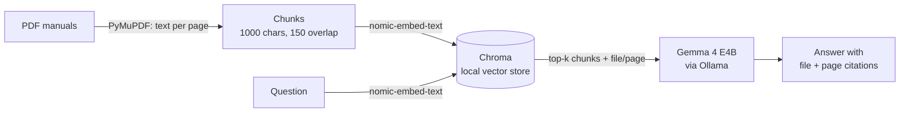

# Local RAG for product-knowledge support in B2B sales

A small assistant that answers technical product questions from PDF manuals and cites the file and page for every fact. It runs **fully offline on a laptop**: no cloud API, no data leaves the machine.

This is the prototype for my BSc thesis *"Local retrieval-augmented language models for product-knowledge support in the B2B sales of industrial SMEs"* (University of Vaasa, 2026). The question behind it: can a small industrial company give its salespeople a reliable "ask the manual" tool without sending product documentation to a cloud service?

## Example

From a logged test run (Nokeval 2021 manual, top-k 5):

```text
Q: A customer needs four alarm relays with changeover contacts on the Nokeval 2021.
   Which alarm cards are needed and in which slots?

A: For four alarm relays with changeover contacts, you need two 2000-REL2 cards,
   with the second card mounted to slot B [1, p. 9]. ...

Retrieved: 2021-Manual-04072011.pdf p. 9, p. 8, p. 9, p. 10, p. 9   (14.2 s on a MacBook Air M2)
```

The same question **without** retrieval (the model answering from its own training) produced *"four Alarm Relay Cards ... installed in slots 1, 2, 3, and 4"*, which is wrong. This is the core point of RAG in a sales setting: the answer has to come from the documentation, with a source the salesperson can check.

## How it works



| Component | Choice | Why |
|---|---|---|
| LLM | `gemma4:e4b` (open-weight, Q4_K_M, about 3.2 GB in memory) | Small enough for a 16 GB laptop, thinking mode switched off for direct answers |
| Embeddings | `nomic-embed-text` | Small, fast English embedding model that runs in Ollama |
| Vector store | Chroma, on disk, telemetry off | No server and no network calls |
| PDF parsing | PyMuPDF | Fast text extraction with page numbers for citations |
| Settings | temperature 0, seed 42, context 8,192 tokens | Repeatable test runs |

The system prompt tells the model to answer **only** from the retrieved excerpts, to cite `[file, p. N]` after each fact, and to reply *"The documentation provided does not answer this."* when the excerpts do not contain the answer.

## Evaluation

The prototype was tested on three public industrial product manuals from Finnish companies, with 31 hand-written questions. The questions were designed to probe typical failure points in sales work, not just easy look-ups:

- **Spec look-ups and tables** (e.g. measuring ranges, power supply options)
- **Variant traps** where a neighbouring model has a different value
- **Inconsistent documentation** where the manual contradicts itself
- **Figure-only content** where the answer exists only in a drawing
- **Finnish-only content** in an otherwise English manual
- **Out-of-scope questions** (price, delivery time, features not in the manual) where the correct answer is to decline

Each manual was run with RAG at top-k 5 and top-k 10, and once without retrieval as a baseline. All runs are logged automatically (answers, retrieved pages, timings, settings, model versions). The table below is generated from those logs with `python evaluation/summarize.py`:

| Manual | Mode | Questions | Expected page retrieved | Mean s / question | Max s |
|---|---|---|---|---|---|
| Labkotec idOil Solar (62 pages) | No RAG (baseline) | 9 | n/a | 2.9 | 5.4 |
| | RAG, top-k 5 | 9 | 6/8 | 10.5 | 15.6 |
| | RAG, top-k 10 | 9 | 7/8 | 17.7 | 26.6 |
| Nokeval 2021 (20 pages) | No RAG (baseline) | 10 | n/a | 3.1 | 6.5 |
| | RAG, top-k 5 | 10 | 8/9 | 9.8 | 14.7 |
| | RAG, top-k 10 | 10 | 8/9 | 22.4 | 38.2 |
| Vaisala PR-23 (270 pages) | No RAG (baseline) | 12 | n/a | 1.6 | 2.8 |
| | RAG, top-k 5 | 12 | 8/10 | 10.5 | 14.1 |
| | RAG, top-k 10 | 12 | 9/10 | 20.9 | 34.3 |

*Expected page retrieved* counts the questions with a known source page where that page was among the retrieved chunks (out-of-scope questions have no source page). Hardware: MacBook Air, Apple M2, 16 GB.

**Observations from the logs**

- **Retrieval** found the right page for 22 of 27 questions at top-k 5 and 24 of 27 at top-k 10. Doubling top-k roughly doubled the response time, from about 10 s to about 20 s per question.
- **Declining works.** In every RAG run the model declined all four out-of-scope questions (prices, delivery times, unsupported protocols) instead of inventing an answer.
- **The baseline hallucinates.** Without retrieval the model answered fast but confidently gave wrong specifications, for example a maximum process temperature of 200 °C for the PR-23-GP (the manual says +150 °C).
- **Figure-only content is the main weakness.** Dimensions that exist only in drawings come out of the text extraction as unlabelled numbers, and the model sometimes pairs them wrongly instead of declining.
- **Citation format is not always followed.** The model sometimes writes `[1, p. 9]` instead of the file name, and occasionally cites a neighbouring page.

The manual scoring of answer correctness (correct / partly / wrong / correctly declined) is part of the thesis and is not included here. All raw answers are in [`evaluation/results/`](evaluation/results/), so they can be checked directly.

## Run it yourself

Requirements: macOS or Linux, Python 3.11+, [Ollama](https://ollama.com) 0.20 or newer (needed for Gemma 4), about 10 GB of disk space for the models.

```bash
# 1. Models
ollama pull gemma4:e4b
ollama pull nomic-embed-text

# 2. Python environment
git clone https://github.com/Onskiboy05/local-rag-product-knowledge.git
cd local-rag-product-knowledge
python3 -m venv .venv && source .venv/bin/activate
pip install -r requirements.txt

# 3. Documents: download a manual into its own folder (links in docs/README.md)
mkdir -p docs/nokeval   # put 2021-Manual-04072011.pdf here

# 4. Build the index and ask
python rag.py --collection nokeval ingest --docs docs/nokeval
python rag.py --collection nokeval ask "What panel cut-out does the Nokeval 2021 need?"

# 5. Re-run the evaluation
python rag.py --collection nokeval test --questions evaluation/questions/nokeval_2021.csv --tag nokeval
python rag.py test --no-rag --questions evaluation/questions/nokeval_2021.csv --tag nokeval
```

New runs are written to `results/`. Turning Wi-Fi off before running `ingest` and `test` shows that everything works locally.

## Repository structure

```text
rag.py                      the whole prototype: ingest, ask, test
requirements.txt
docs/README.md              where to download the manuals (PDFs are not included)
evaluation/
  questions/                31 test questions with expected answers and source pages
  results/                  logged runs per manual: answers, timings, settings
  summarize.py              rebuilds the results table above from the logs
```

## Limitations and next steps

- **Figures and tables:** text extraction loses drawings and table structure. Next step: a vision-capable model or table-aware parsing for figure-heavy pages.
- **Language:** `nomic-embed-text` is English-only, so Finnish content is hard to retrieve. A multilingual embedding model (e.g. `bge-m3`, already supported with `--embed`) is the obvious fix for Finnish SMEs.
- **Interface:** a command-line tool is fine for testing but not for salespeople. Next step: a simple chat interface where users drag in PDFs.
- **Scale:** tested on one manual at a time. A real product portfolio needs metadata filtering by product and document version.
- **Enterprise setting:** the same pipeline could run on Azure OpenAI or Microsoft-hosted models where data residency rules allow it, trading the fully local setup for easier deployment.

## Author

Onni Ovaskainen, Industrial Engineering and Management, University of Vaasa
[LinkedIn](https://linkedin.com/in/onniovaskainen)

The manuals belong to their publishers (Labkotec, Nokeval, Vaisala) and are only linked, not redistributed.
